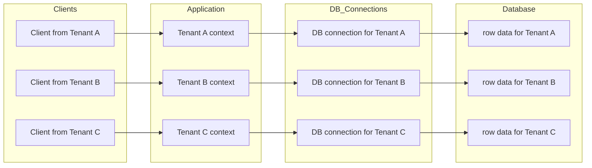
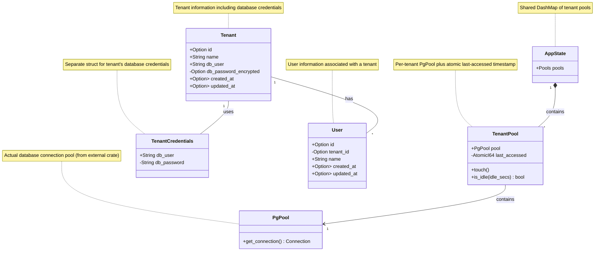
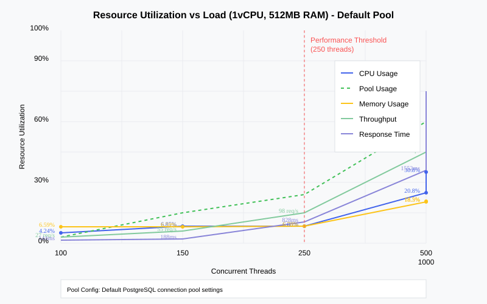

# Scalable, Multi-Tenant Architecture template written in Rust for PostgreSQL
Multi-threaded DB pool lifecycle management implementation is available in the source provided.

[](https://github.com/alexandrughinea/rust-actix-postgres-multi-tenant/actions/workflows/rust.yml)
[](https://opensource.org/licenses/MIT)

This project implements a relatively fast multi-tenant connection pooling strategy for PostgreSQL using Rust.
It dynamically manages database connection pools for tenants based on their unique identifiers (UUIDs).
The architecture uses a sharded `DashMap` of tenant pools and SQLx so lookups from different tenants do not serialize on a global lock.

## Table of Contents
- [Overview](#overview)
- [Architecture](#architecture)
- [Components](#components)
- [How it Works](#how-it-works)
- [Benefits](#benefits)
- [Documentation](#documentation)
- [Disclaimer](#disclaimer)

## Overview

In a multi-tenant application, each tenant often requires its own isolated database or schema.
Managing connections to these tenants in an efficient way is extremely critical for performance and resource re-utilization.
This project provides one way to handle tenant-specific database connections using connection pools that are cached and reused, ensuring optimized resource management.
The main database we're working with is going to be PostgreSQL and it assumes that RLS (Row Level Security) is enabled as a security policy for each connecting tenant as the following diagram:


Each tenant role has its own credentials stored and encrypted (not hashed) at rest with an AES256 GCM algorithm.
The encryption key is not part of the app binary and is configured per environment.

The architecture supports:
- **Tenant-specific connection pooling**: A separate connection pool for each tenant, ensuring a good level of isolation between tenants.
- **Efficient reuse of connections**: Pools are cached and reused to avoid repeatedly creating and tearing down connections.
- **Pool eviction strategy**: Pools are evicted and cleaned up if they become stale by an automatic background task.
- **Concurrent map**: Tenant pools live in a sharded `DashMap`, so lookups for different tenants do not contend on a single mutex.

## Architecture

### Components

- **`AppState`**: Shared application state. `pools` is a `DashMap<Uuid, TenantPool>` (aliased as `Pools`). `web::Data<AppState>` already wraps this in an `Arc`, so the map does not need another outer lock. Each tenant keeps its own credentials and its own `PgPool`.

- **`TenantPool`**: A tenant's `PgPool` plus an atomic Unix-second `last_accessed` timestamp (`touch` / `is_idle`). `PgPool` is already a cheap `Clone` (internally reference-counted), so it is not wrapped in an extra `Arc` or `Mutex`.

- **PostgreSQL Pool (`PgPool`)**: The control-plane pool that starts with the application (migrations, tenant credential lookup). Per-tenant work uses the cached `TenantPool.pool`, not this one.

### Diagram



## How it Works

1. **Request Handling**:
   - When a request is made on behalf of a tenant, the `tenant_id` (UUID) is extracted from the request.

2. **Connection Pool Lookup**:
   - The system looks up the tenant in `AppState.pools` with `DashMap::get`. On a hit it calls `touch()` (atomic last-accessed) and returns a cloned `PgPool`. Unrelated tenants do not share a lock.

3. **Pool Creation** (if not found):
   - Credentials are fetched and a new `PgPool` is connected **without** holding a map guard, so other tenants can keep looking up while this tenant is cold.
   - The new pool is inserted with `DashMap::entry`. If another request won the race, the extra pool is closed and the existing one is used.

4. **Idle cleanup**:
   - A background task periodically `retain`s pools that are not `is_idle`. Dropping a map entry drops that tenant's `PgPool` once in-flight clones are gone.

5. **Reusing Pools**:
   - Once a pool is created for a tenant, subsequent requests from that tenant reuse the same pool, avoiding the overhead of creating new connections repeatedly.

## Benefits

### 1. **Efficient Connection Management**:
- The architecture ensures that connections to tenant databases are pooled and reused. Each tenant gets its own `PgPool`, and the pool is created only when needed, reducing overhead.

### 2. **Scalability**:
- Lookups for different tenants run concurrently on the sharded map; a cold connect no longer blocks every other tenant. The practical ceiling is Postgres itself: each cached tenant holds its own `PgPool` (2–4 connections in the default config), so connection count grows with live pools, not with DashMap contention.

### 3. **Optimized Resource Usage**:
- The architecture reduces the cost of frequently opening and closing database connections by keeping idle connections around for a specified amount of time (configurable using the `idle_timeout` setting).

### 4. **Isolation Between Tenants**:
- Each tenant’s database pool is isolated, ensuring that tenants don’t interfere with one another’s connections. This is crucial for maintaining security and data integrity in multi-tenant systems.

### 5. **Cache Management**:
- `touch()` / `is_idle()` drive idle eviction: unused pools are dropped from the map on a timer so connection slots go back to Postgres.

## Documentation

For extra info you should really check out the `documentation/` directory.
I have left some resources that I think could bring even more insight.

It is split in three main sections:
- Stress test results for custom and default pool settings: [stress test results](./documentation/stress_test)
- SQL migration steps with comments:  [SQL docs](./documentation/sql)
- [Bruno](https://github.com/usebruno/bruno) API collections: [Bruno templates](./documentation/bruno)

### Stress test result example

#### Result format (jmx output) [512GB_1vCPU_250_CT_summary](./documentation/stress_test/default_pool_options/512GB_1vCPU_250_CT_summary.csv):

| Label                    | # Samples | Average | Min | Max  | Std. Dev. | Error % | Throughput | Received KB/sec | Sent KB/sec | Avg. Bytes |
|--------------------------|-----------|---------|-----|------|-----------|---------|------------|----------------|-------------|------------|
| Thread Group:HTTP Request | 5000      | 828     | 83  | 3326 | 604.89    | 0.000%  | 98.33035   | 260.61         | 25.45       | 2714.0     |
| TOTAL                    | 5000      | 828     | 83  | 3326 | 604.89    | 0.000%  | 98.33035   | 260.61         | 25.45       | 2714.0     |

#### Result graph - Resource Utilization vs Load (1vCPU, 512MB RAM) - Default Pool:


## Usage

### Prerequisites
- Rust
- PostgreSQL
- SQLx with PostgreSQL feature

### Setting up the Project

1. Clone the repository:
   ```bash
   git clone <repository-url>
   ```
2.	Configure your own PostgreSQL connection settings for your tenants.
      Look for .env and enable it accordingly.

3. Seed your `tenants` table accordingly (see `/sql` directory)

4. Making tenant specific requests

- `POST` request to create a user for a specific tenant:
  ```bash
  curl -X POST https://localhost:8080/v1/internal/users \
       -H "x-tenant-id: 1b7db059-91bc-42d6-9d0e-93ca03d644a8" \
       -H "Content-Type: application/json" \
       -d '{
             "name": "John Doe",
           }'
  ```

- `GET` request to retrieve users of a specific tenant:
  ```bash
  curl -X GET https://localhost:8080/v1/internal/users \
     -H "x-tenant-id: 1b7db059-91bc-42d6-9d0e-93ca03d644a8"
  ```
Be sure to add an existing and correct tenant unique identifier in the headers (must be UUID v4)

## Disclaimer

This should be considered a starting point or a good conversation starter.
It is missing many important items such as a proper build pipeline, telemetry and security aspects such as a secret vault for storing database connection credentials or a rotating encryption key, etc.
Please be sure to upgrade your security posture.